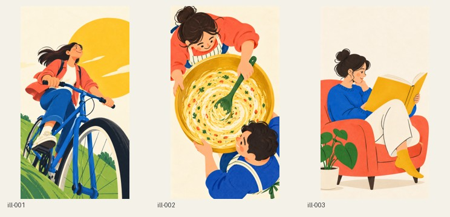
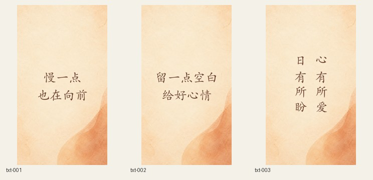
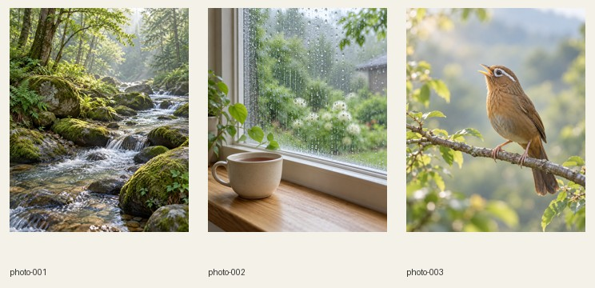

# 系列化图片工厂 · V1.0

把参考图变成可复用的风格包，再按主题表生成图片。适用于插画、精确中文壁纸、摄影感封面。主题可以变，风格规则独立保存；以后交给别人也能接着用。

本包包含一个通用 Skill、三个独立示范风格、三份任务表、离线处理脚本和实际案例。它不是独立生图网站：图像由 AI 助手所在环境提供的图像工具生成，本地脚本负责计划、排字、归档、验证和预览。

## 先准备什么

- 支持读取 Skill 的 AI 助手；实际出图还需宿主提供生图工具。
- 参考图或明确的文字风格描述，以及本批主题、数量和使用尺寸。
- 使用脚本：Python 3.10+。编译只用标准库，处理图片需 Pillow。
- 做中文壁纸：本机可用并许可使用的中文字体文件。字体不会随本包分发。

不要求配置指定付费 API Key；没有图像工具时可以先完成计划。生图工具自身的额度、权限和费用按所在环境处理，本包不代购或后台调用 API。

## 安装

推荐在支持安装器的 Codex 中发送：

```text
$skill-installer 请安装这个完整目录：
https://github.com/972173242qqcom-sudo/shared-ai-skills/tree/main/skills/image-series-factory
```

没有安装器时，下载公开仓库 ZIP，把完整的 `skills/image-series-factory` 文件夹放到当前客户端支持的用户 Skill 目录。当前官方 Codex 文档使用 `~/.agents/skills/`（Windows 为 `%USERPROFILE%\.agents\skills\`），项目级目录为 `.agents/skills/`。本项目的既有私有仓库安装脚本沿用 `~/.codex/skills/`；这是已有环境的兼容路径，不应当作所有新客户端的默认值。按当前客户端和安装器实际设置选择一处，避免重复安装同名技能。不要覆盖已有自定义目录。[官方本地 Skill 路径与安装说明](https://learn.chatgpt.com/docs/build-skills)

安装后开一个新会话，输入：

```text
读取 $image-series-factory，告诉我三个示例风格分别适合什么。
暂时不要生成图片。
```

应能解释插画、壁纸、摄影封面的不同规则。未识别时检查是否多嵌套了一层目录，确保安装目录里直接包含 `SKILL.md`。Skill 是可移植的指令和资源目录，工具能力仍由宿主提供。[官方 Skill 说明](https://developers.openai.com/plugins/concepts/skills)

本机私有主仓库用户也可以运行已有的 `scripts/install_codex_skills.sh`，其链接机制保持不变。

## 有自己的参考图：复制这段提示词

先上传一张或多张参考图，再复制下面的提示词，将【】中的内容替换为自己的需求。这套用法适用于新画风、新主题，不限于后面的三个示例；不需要自己编写风格 JSON 或任务表。

```text
使用 $image-series-factory。

我已上传参考图片，请以这些图片的视觉风格为主要依据，
帮我创作一组新的系列化图片。

我的需求：
- 用途：【例如手机壁纸、内容封面、人物插画、产品场景配图】
- 最终数量：【例如10张，通过的小样计入总数】
- 图片比例或尺寸：【例如9:16、4:5、1080×1920】
- 系列主题：【例如春日旅行、日常松弛、不同动物；没有想法时请先建议】
- 文字要求：【无文字／使用我提供的准确文案】
- 其他要求：【例如主体完整、预留裁切空间、固定同一角色；没有可删】

请按以下方式完成：
1. 先分析参考图的色彩关系、线条与形体、材质与光影、构图留白、
   文字气质和整体情绪，提炼哪些特征固定、哪些内容可以变化。
   如果多张参考图的风格存在明显冲突，请先说明，并建议统一方向。
2. 根据本次参考建立独立风格包，不直接套用内置案例的画风。
   参考图中的具体人物、场景、姿势、文案和标志，默认不照搬；
   如果我明确指定需要保留的元素，请单独记录。
3. 围绕我的主题规划不同的画面内容与构图，使每张有实际差异，
   同时保持整组视觉语言一致，不只是对同一画面反复换色。
4. 先生成3张差异明显的小样供我确认；若最终数量不足3张，
   则按实际数量生成。说明它们如何保持系列感，以及哪些方面做了变化。
5. 我确认方向后，再补齐剩余图片，并逐张检查风格、主题、尺寸和文字。
   如有准确中文文案，请保留原文，优先生成无字底图后精确排字。
6. 将风格包、任务表、实际提示词、终稿、质检记录和整批预览保存到
   当前项目的新文件夹，方便以后继续扩展同一系列。
```

**想先快速尝试，也可以只发这一句：**

```text
使用 $image-series-factory，参考我上传图片的视觉风格，
为【主题】创作【数量】张【比例】的系列图片。
先提炼风格并建立独立风格包，再生成最多3张不同内容和构图的小样，
小样数量不超过最终总数。
保持风格统一，默认不照搬参考图中的具体画面和文字，确认后再完成整批。
```

上传多张图时，可以补一句“图1主要参考配色，图2主要参考人物造型，图3主要参考构图”。有必须保留的角色或元素，也请明确指出，避免助手把它当作仅供参考的内容。

### 继续已有系列与指定返工

继续已有系列：

```text
使用 $image-series-factory，沿用 my-series 的已确认风格版本。
新增3个主题：园艺、出门旅行、周日午睡。
先查看旧任务，避免重复场景和动作，保存为 batch-v02。
```

指定返工：

```text
只修改 photo-003：画眉鸟白眉纹不够明确。
保留现有柔光、背景和配色，强化物种识别特征。
保存成新修订批次，不改其他已通过图片。
```

## 案例一：明快生活插画

风格包：[editorial-pop.json](assets/style-packs/editorial-pop.json)；任务：[illustration/tasks.jsonl](examples/illustration/tasks.jsonl)。

固定：简化成人、钴蓝/珊瑚/金黄/绿色关系、平涂、少量深线、简洁环境。可变：骑车、合作做饭、阅读，以及低机位、俯视、侧面镜头。示范输出为 720×1280，实际任务可指定其他尺寸。



给助手：

```text
读取本 Skill 的 editorial-pop 风格包和 illustration 示例任务，
在新输出目录编译并实际生成3张图，不复用历史项目图片。
检查整组风格是否一致、三张构图是否不同。
```

## 案例二：准确中文壁纸

风格包：[warm-paper-type.json](assets/style-packs/warm-paper-type.json)；任务：[wallpaper/tasks.jsonl](examples/wallpaper/tasks.jsonl)。

固定：暖纸底、安静中心、深暖棕文字。可变：文案、横排/竖排。示范为1080×1920。先生成一张无字背景，作为已确认母版用于三张不同文案；不是要求模型在每张图里重新写字。



```text
使用暖纸文字壁纸包，先生成无字背景，再精确排入示例任务原文。
前两张横排，第三张两列竖排，阅读顺序从右到左。
检查本机字体，优先选择已许可的中文楷体；不要分发字体文件。
逐字看图确认，没有合适字体就告诉我，不用缺字方框代替。
```

参考文字是风格线索还是最终文案，应事先区分。需要更换字体时记录字体与字面，不把另一台电脑缺字体当作生图失败。

## 案例三：白噪音摄影封面

风格包：[quiet-photo-cover.json](assets/style-packs/quiet-photo-cover.json)；任务：[white-noise/tasks.jsonl](examples/white-noise/tasks.jsonl)。

固定：柔和自然光、低刺激配色、真实摄影感、缩略图主题明确。三个主题是林间溪流、窗边细雨、清晨画眉，输出800×1000（4:5）。画眉任务明确要求白眼圈和眼后白眉纹。



```text
使用静谧摄影封面包，生成白噪音示例的3张封面。
本次按场景描述验证，不代表已经听过或匹配真实音频。
检查雨滴、溪流、鸟的识别特征在小图下仍然明确。
输出 AI 生成来源备注和整批预览。
```

如改用照片库素材，另记来源和授权，不能把参考照片随 Skill 公开。

## 手动跑脚本

以下在本 Skill 文件夹执行。虚拟环境与输出建在你的项目中；如目录不可写，改用可写工作区绝对路径。

```bash
python3 -m venv .venv
# macOS/Linux
source .venv/bin/activate
# Windows PowerShell 改用 .venv\Scripts\Activate.ps1
python -m pip install -r requirements.txt

python scripts/series.py compile --pack assets/style-packs/editorial-pop.json --tasks examples/illustration/tasks.jsonl --out my-output/illustration-v01
```

这时只有计划。让助手读取 `manifests`，调用可用图像工具，得到真实图片后导入：

```bash
python scripts/series.py ingest --batch my-output/illustration-v01 --id ill-001 --image /path/to/generated-image.png
python scripts/series.py report --batch my-output/illustration-v01
```

壁纸导入另加 `--font /path/to/font.ttf`；TTC 可加 `--font-index 0`。对原生尺寸不足的图片，先考虑重生成，明确接受插值放大时才加 `--allow-upscale`；超过2%的比例裁切需 `--allow-crop` 并检查主体。脚本不拉伸。

检查图片后按 [审核格式](references/formats.md) 写一份真实的 `review.json`，再执行：

```bash
python scripts/series.py review --batch my-output/illustration-v01 --id ill-001 --checks review.json
python scripts/series.py report --batch my-output/illustration-v01 --require-complete
```

`--require-complete` 在漏图、未审核或未通过时返回非零状态。不要把示例中的 pass 记录复制成未看图的审核结论。

## 换成自己的新风格

复制最接近的风格 JSON 到项目中，用新 `id` 和版本；填写色彩、形体、材质、构图与禁用项。重新校准小样。单纯换主题只改任务表，改变视觉身份则改风格包。见 [风格分析卡](references/style-packs.md)。

## 失败排查

| 现象 | 处理 |
| --- | --- |
| 有提示词却没有图片 | compile 仅编译；检查宿主生图工具是否可用 |
| 每张像不同画师 | 回查风格快照，删掉任务中互相冲突的风格词 |
| 整组长得一样 | 改主题/动作/镜头，不只换颜色 |
| 中文缺字或文字放不下 | 选择完整字体、正确字面，明确调整布局或缩短文案 |
| 尺寸不符 | 重新构图或明确裁切；不拉伸、不虚称原生高清 |
| 无法覆盖旧批次 | 这是保护机制，使用新的版本目录 |
| 技术通过但仍 pending | 还未记录实际视觉审核 |
| 改图后审核失效 | 当前终稿哈希已变化，重新看图并建修订批次 |

## 验证与限制

本版验证范围见 [验证记录](VALIDATION.md)，实际案例见 `examples/*/result/`。案例图片为新生成的教学内容；风格和语义由助手视觉检查，用户审美仍可继续校准。未验证百张并发、无人值守运行或不同生图服务的等价质量。

Python 脚本可跨平台运行，但本次环境与字体实测见验证记录；不宣称已在 Windows/Linux 实机验证。本包不附字体；字体、Pillow版本变化可能改变排字像素。更新时完整替换 Skill 前先备份自己的修改；复制安装不会自动更新。

本目录代码与文档按 [MIT](LICENSE) 授权。新生成示例的使用说明见 [素材说明](ASSETS.md)；不保证生成内容独占性，不授权任何第三方字体或参考图。
